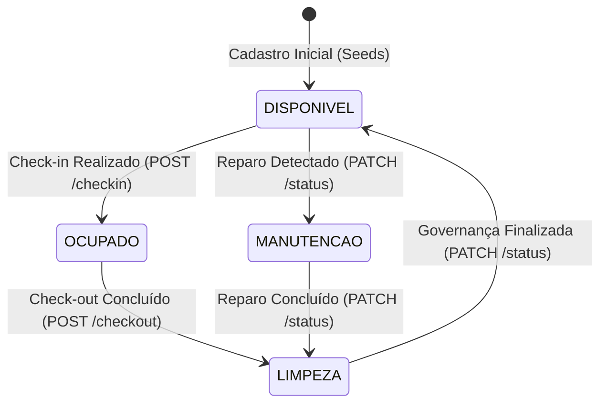
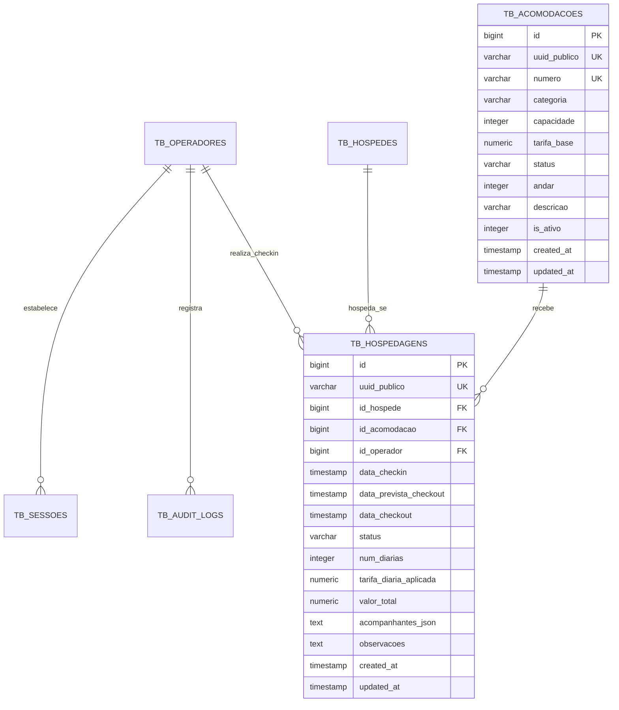

# DOCUMENTO DE ESPECIFICAÇÃO DE REQUISITOS E ARQUITETURA SEGURA (SSD)
## Laboratório de Inovação III — Prof. Edilberto Silva — 2026

---

## 1. METADADOS DO PROJETO E DA EQUIPE

### 1.1 Composição da Equipe (GRUPO-06 — SEMANA-05)

| ID | Nome Completo | Papel Primário | Papel Secundário | E-mail Institucional / Contato |
| :---: | :--- | :--- | :--- | :--- |
| 1 | **João Miguel Paiva Velloso Ramos Pereira** | Scrum Master | Desenvolvedor Back-End | `jguel0713@gmail.com` |
| 2 | **João Victor Sousa da Conceição** | Desenvolvedor Front-End | QA / SecDevOps | `joao47064706@edu.df.senac.br` |

**Lista de Integrantes para o Moodle:**  
`jguel0713@gmail.com; joao47064706@edu.df.senac.br`

### 1.2 Identificação do Projeto

- **NOME_DO_PROJETO:** Grand Plaza Hotel Management System
- **DESCRICAO_BREVE:** Sistema web corporativo em arquitetura SPA para gestão hoteleira com controle do ciclo completo de hospedagem, alocação de acomodações físicas, Rack Hoteleiro interativo de recepção, check-in ágil com bloqueio atômico anti-overbooking, check-out com apuração contábil automática de diárias consumidas e governança de quartos (liberação para limpeza e manutenção).
- **VERSAO_DO_SISTEMA:** 1.4.0 (Semana 05 / Sprint RF-004)

### 1.3 Localização dos Artefatos

- **PACOTE_DE_ENTREGA:** `GRUPO-06-SEMANA-05.zip` (ou `GRUPO-Dimitri-SEMANA-05.zip`)
- **LINK_REPOSITORIO_GITHUB:** https://github.com/Dimmy-dev/grand-hotel
- **BRANCH_PRINCIPAL:** `main`
- **LINK_APLICACAO_DEPLOY:** https://grand-hotel-tawny.vercel.app
- **LINK_BANCO_DADOS:** Supabase PostgreSQL 15+ (Datacenter São Paulo `sa-east-1` via PgBouncer na porta 6543) + SQLite local de resiliência empacotado (`hotel_grand_plaza.db`)
- **LINK_API_SWAGGER:** https://grand-hotel-tawny.vercel.app/docs
- **ARQUIVO_SWAGGER_LOCAL:** `docs/api/swagger.json`

---

## 2. ESTRUTURA DE DIRETÓRIOS DO PROJETO

```text
Trabalho_Edilberto/
├── docs/
│   ├── requisitos/
│   │   ├── RF-001-cadastro-hospede.md        <-- Semana 01 e 02
│   │   ├── RF-002-alterar-hospede.md         <-- Semana 03
│   │   ├── RF-003-cadastro-usuario.md         <-- Semana 04
│   │   └── RF-004-hospedagem.md              <-- ESTE DOCUMENTO OFICIAL (Semana 05)
│   └── api/
│       └── swagger.json                       <-- Contrato OpenAPI 3.1 com endpoints do RF-004
│
├── src/
│   ├── rf-001-cadastro-hospede/
│   ├── rf-002-alterar-hospede/
│   ├── rf-003-cadastro-usuario/
│   └── rf-004-hospedagem/                     <-- CÓDIGO-FONTE DESTE REQUISITO
│       ├── index.html                        <-- SPA com Rack Hoteleiro e Modais de Estadia
│       ├── app.js                            <-- Cliente JavaScript (Reativo, Fetch com Credentials)
│       ├── main.py                           <-- Backend FastAPI com Check-in Atômico e Check-out
│       ├── schemas.py                        <-- Schemas Pydantic v2 com validações estritas
│       ├── models.py                         <-- Modelos ORM SQLAlchemy (Acomodações e Hospedagens)
│       ├── database.py                       <-- Provedor resiliente dual (Supabase / SQLite local)
│       ├── hotel_grand_plaza.db              <-- Banco SQLite local com quartos semeados
│       ├── requirements.txt                  <-- Dependências Python
│       └── README.md                         <-- Manual de homologação e execução local
│
├── database/
│   ├── ddl/
│   │   ├── rf-001-hospedes-ddl.sql
│   │   ├── rf-002-hospedes-alter-ddl.sql
│   │   ├── rf-003-operadores-ddl.sql
│   │   └── rf-004-hospedagens-ddl.sql         <-- Script DDL com tb_acomodacoes e tb_hospedagens
│   ├── seeds/
│   │   ├── hospedes-seeds.sql
│   │   └── acomodacoes-seeds.sql              <-- Carga inicial de quartos dos andares 1 a 3
│   └── supabase_setup.sql                     <-- Script mestre consolidado idempotente
│
├── regras/
│   ├── front.md                              <-- Diretrizes de UI, Design Tokens e SPA Antisslop
│   ├── back.md                               <-- Arquitetura Backend, Segurança e Endpoints
│   ├── DB.md                                 <-- Especificação do Banco de Dados Relacional
│   └── documentação.md                       <-- Manual de Governança e Rubrica
│
├── api/
│   └── index.py                              <-- Adaptador Serverless para a Vercel (prioriza RF-004)
├── vercel.json                               <-- Configuração de rotas de produção
├── requirements.txt                          <-- Dependências raiz do projeto
├── README.md                                 <-- Guia geral do repositório
└── .gitignore                                <-- Exclusão de arquivos sensíveis e temporários
```

---

# DETALHAMENTO DO REQUISITO FUNCIONAL: RF-004

---

## 🎯 1. IDENTIFICAÇÃO DO REQUISITO

- **ID:** RF-004
- **Título:** Ciclo Completo de Hospedagem, Alocação de Acomodações, Check-in, Check-out e Rack Hoteleiro
- **Tipo:** Requisito Funcional
- **Prioridade:** CRÍTICA (Núcleo de negócio do hotel: viabiliza a ocupação dos quartos, controle espacial de leitos, faturamento das estadias e gestão de governança)
- **Complexidade:** ALTA (8 Story Points — envolve concorrência atômica com lock pessimista anti-overbooking, máquina de estados da acomodação, congelamento histórico de tarifas contratadas, apuração contábil no checkout e interface em grid responsivo)
- **Status:** CONCLUÍDO
- **Data de Criação:** 30/09/2026
- **Última Atualização:** 14/10/2026

**Breve Descrição:**  
O RF-004 implementa o ciclo vital da operação hoteleira no Grand Plaza Hotel. A recepção gerencia as dependências físicas através do **Rack Hoteleiro**, uma interface visual interativa em grade que reflete em tempo real o status de cada acomodação (`DISPONIVEL`, `OCUPADO`, `LIMPEZA`, `MANUTENCAO`). A partir do Rack, recepcionistas vinculam hóspedes previamente cadastrados a quartos disponíveis em um fluxo de **Check-in Ágil**, prevenindo atômica e simultaneamente qualquer risco de sobreposição de reservas (*overbooking*). No término da estadia, o **Check-out com Faturamento Inicial** calcula com exatidão as diárias consumidas (garantindo o mínimo de 1 diária integral) e encaminha a acomodação para o fluxo de governança/higienização.

---

## 2. REQUISITOS NÃO FUNCIONAIS E ARQUITETURA SEGURA (RNF)

1. **RNF-01 (Atomicidade e Anti-Overbooking)**:
   - Toda alocação de quarto no check-in é protegida por nível de isolamento de transação e lock pessimista (`SELECT ... FOR UPDATE` no PostgreSQL). Se duas recepcionistas tentarem ocupar o mesmo quarto simultaneamente, uma transação vence e a concorrente recebe `HTTP 409 Conflict`.
2. **RNF-02 (Imutabilidade Contábil da Tarifa)**:
   - A tarifa base da acomodação é clonada no registro da hospedagem (`tarifa_diaria_aplicada`). Alterações posteriores no valor da diária do hotel não retroagem sobre estadias ativas ou passadas.
3. **RNF-03 (Performance do Rack Hoteleiro)**:
   - O tempo de resposta de `GET /api/v1/acomodacoes` deve ser inferior a 150ms via índices B-Tree compostos nas colunas `status` e `categoria`.
4. **RNF-04 (Resiliência Dual Transparente)**:
   - Se a conexão de rede com o Supabase PostgreSQL oscilar, o backend comuta para o SQLite local sem interrupção de serviço, inicializando automaticamente as tabelas e seeds da Semana 05.
5. **RNF-05 (Auditoria LGPD e Segurança da Informação)**:
   - Check-in, check-out e alterações de governança geram logs imutáveis com ID do operador, IP e carimbo de tempo UTC na tabela `tb_audit_logs`.

---

## 3. MÁQUINA DE ESTADOS E REGRAS DE NEGÓCIO (RN)

### 3.1 Diagrama de Estados da Acomodação (Mermaid)



### 3.2 Regras de Negócio Estritas

* **RN-01 (Check-in Apenas em Quarto Disponível)**:
  * Check-in só pode ser efetuado em quartos com status `DISPONIVEL`. Quartos em `LIMPEZA`, `MANUTENCAO` ou `OCUPADO` rejeitam a operação com `HTTP 409 Conflict`.
* **RN-02 (Validação de Hóspede Cadastrado)**:
  * O hóspede deve existir em `tb_hospedes` e estar com `is_ativo = 1`.
* **RN-03 (Data Futura de Saída)**:
  * A data prevista de saída (`data_prevista_checkout`) deve ser estritamente posterior à data e hora do check-in.
* **RN-04 (Apuração de Diárias no Check-out)**:
  * O cálculo do número de diárias adota a regra hoteleira padrão:
    $$\text{horas} = \frac{\text{data\_checkout} - \text{data\_checkin}}{3600}$$
    $$\text{diarias} = \begin{cases} 1, & \text{se horas} \le 24 \\ \lceil \frac{\text{horas}}{24} \rceil, & \text{se horas} > 24 \end{cases}$$
    $$\text{valor\_total} = \text{diarias} \times \text{tarifa\_diaria\_aplicada}$$
* **RN-05 (Destino Pós-Checkout)**:
  * Imediatamente após o checkout, o quarto é marcado como `LIMPEZA`. Ele não pode ser vendido até que a recepção/governança libere explicitamente a acomodação para `DISPONIVEL`.

---

## 4. MODELAGEM RELACIONAL E DICIONÁRIO DE DADOS

### 4.1 Diagrama Entidade-Relacionamento Completo (Mermaid ERD)



### 4.2 Dicionário da Tabela `tb_acomodacoes`

| Coluna | Tipo | Nulo? | Padrão | Descrição |
| :--- | :--- | :---: | :--- | :--- |
| `id` | `BIGSERIAL` | Não | Auto-increment | Chave primária física interna (B-Tree). |
| `uuid_publico` | `VARCHAR(36)` | Não | UUID v4 | Chave universal pública exposta em URLs REST. |
| `numero` | `VARCHAR(10)` | Não | — | Número de porta do quarto (ex: "101", "201", "305"). |
| `categoria` | `VARCHAR(30)` | Não | — | Categoria: `STANDARD`, `LUXO`, `PRESIDENCIAL`. |
| `capacidade` | `INTEGER` | Não | `2` | Número máximo de hóspedes comportados. |
| `tarifa_base` | `NUMERIC(10,2)`| Não | — | Tarifa base por diária em Reais (R$). |
| `status` | `VARCHAR(20)` | Não | `'DISPONIVEL'` | Estado operacional: `DISPONIVEL`, `OCUPADO`, `LIMPEZA`, `MANUTENCAO`. |
| `andar` | `INTEGER` | Não | `1` | Andar físico do hotel. |
| `descricao` | `VARCHAR(255)`| Sim | NULL | Descrição das comodidades do quarto. |
| `is_ativo` | `INTEGER` | Não | `1` | Ativação lógica (1=Ativo, 0=Inativo). |

### 4.3 Dicionário da Tabela `tb_hospedagens`

| Coluna | Tipo | Nulo? | Padrão | Descrição |
| :--- | :--- | :---: | :--- | :--- |
| `id` | `BIGSERIAL` | Não | Auto-increment | Chave primária surrogate interna. |
| `uuid_publico` | `VARCHAR(36)` | Não | UUID v4 | Identificador público da estadia. |
| `id_hospede` | `BIGINT` | Não | — | FK para `tb_hospedes(id)` (`ON DELETE RESTRICT`). |
| `id_acomodacao` | `BIGINT` | Não | — | FK para `tb_acomodacoes(id)` (`ON DELETE RESTRICT`). |
| `id_operador` | `BIGINT` | Sim | NULL | FK para `tb_operadores(id)` (`ON DELETE SET NULL`). |
| `data_checkin` | `TIMESTAMPTZ` | Não | `now()` | Momento exato da entrada do hóspede. |
| `data_prevista_checkout` | `TIMESTAMPTZ` | Não | — | Previsão inicial de saída declarada na recepção. |
| `data_checkout` | `TIMESTAMPTZ` | Sim | NULL | Momento da realização do check-out. |
| `status` | `VARCHAR(20)` | Não | `'ATIVA'` | Status da estadia: `ATIVA`, `FINALIZADA`, `CANCELADA`. |
| `num_diarias` | `INTEGER` | Sim | NULL | Número de diárias apuradas no check-out. |
| `tarifa_diaria_aplicada`| `NUMERIC(10,2)`| Não | — | Snapshot da tarifa diária congelada na entrada. |
| `valor_total` | `NUMERIC(10,2)`| Sim | NULL | Valor faturado final calculado no check-out. |
| `acompanhantes_json` | `TEXT` | Sim | NULL | Lista de acompanhantes em formato JSON. |
| `observacoes` | `TEXT` | Sim | NULL | Observações e solicitações especiais. |

---

## 5. ESPECIFICAÇÃO DE ENDPOINTS REST (CONTRATO OPENAPI)

Todos os endpoints operam sob o padrão Envelope REST:
```json
{
  "success": true,
  "data": { ... },
  "error": null
}
```

### 5.1 `GET /api/v1/acomodacoes`
* **Descrição**: Retorna o inventário de quartos com status e dados da estadia em curso.
* **Query Params**: `status` (opcional), `categoria` (opcional).
* **Resposta 200 OK**:
  ```json
  {
    "success": true,
    "data": [
      {
        "uuid_publico": "c1010000-0000-0000-0000-000000000101",
        "numero": "101",
        "categoria": "STANDARD",
        "capacidade": 2,
        "tarifa_base": "280.00",
        "status": "DISPONIVEL",
        "andar": 1,
        "descricao": "Quarto Standard com cama Queen e Wi-Fi 6",
        "hospedagem_ativa": null
      }
    ],
    "error": null
  }
  ```

### 5.2 `POST /api/v1/hospedagens/checkin`
* **Descrição**: Realiza o check-in ágil com bloqueio exclusivo anti-overbooking.
* **Corpo da Requisição**:
  ```json
  {
    "uuid_hospede": "d4e5f6a7-b8c9-0d1e-2f3a-4b5c6d7e8f9a",
    "uuid_acomodacao": "c1010000-0000-0000-0000-000000000101",
    "data_prevista_checkout": "2026-10-16T12:00:00Z",
    "acompanhantes": ["Beatriz Albuquerque"],
    "observacoes": "Andar silencioso"
  }
  ```
* **Resposta 201 Created**:
  ```json
  {
    "success": true,
    "data": {
      "uuid_hospedagem": "7a8b9c0d-1e2f-3a4b-5c6d-7e8f9a0b1c2d",
      "quarto_numero": "101",
      "quarto_categoria": "STANDARD",
      "hospede_nome": "Dr. Fernando Albuquerque",
      "data_checkin": "2026-10-14T07:15:00Z",
      "data_prevista_checkout": "2026-10-16T12:00:00Z",
      "tarifa_diaria_aplicada": 280.0,
      "status": "ATIVA",
      "mensagem": "Check-in do hóspede Dr. Fernando Albuquerque no Quarto 101 concluído com sucesso!"
    },
    "error": null
  }
  ```

### 5.3 `POST /api/v1/hospedagens/{id_ou_uuid}/checkout`
* **Descrição**: Encerra a estadia, calcula diárias e direciona o quarto para limpeza.
* **Resposta 200 OK**:
  ```json
  {
    "success": true,
    "data": {
      "uuid_publico": "7a8b9c0d-1e2f-3a4b-5c6d-7e8f9a0b1c2d",
      "hospede_nome": "Dr. Fernando Albuquerque",
      "hospede_cpf": "52998224725",
      "acomodacao_numero": "101",
      "acomodacao_categoria": "STANDARD",
      "data_checkin": "2026-10-14T07:15:00Z",
      "data_checkout": "2026-10-14T07:30:00Z",
      "num_diarias": 1,
      "tarifa_diaria_aplicada": "280.00",
      "valor_total": "280.00",
      "status": "FINALIZADA",
      "quarto_status_atual": "LIMPEZA"
    },
    "error": null
  }
  ```

### 5.4 `PATCH /api/v1/acomodacoes/{id_ou_uuid}/status`
* **Descrição**: Atualização de governança (libera quarto limpo para `DISPONIVEL`).
* **Corpo**: `{ "status": "DISPONIVEL" }`
* **Resposta 200 OK**: Retorna o objeto da acomodação com status atualizado.

---

## 6. SEGURANÇA DA INFORMAÇÃO E OWASP TOP 10

* **OWASP A01 (Broken Access Control)**:
  * Rotas de check-in, check-out e governança exigem operador logado autenticado via cookie seguro HttpOnly. Operadores inativos são sumariamente rejeitados.
* **OWASP A03 (Injection)**:
  * 100% das consultas utilizam ORM parametrizado (SQLAlchemy 2.0). Nenhuma concatenação dinâmica de strings SQL é realizada.
* **OWASP A04 (Insecure Design - Concorrência)**:
  * Prevenção de race condition de overbooking através de transação com lock pessimista em linha (`with_for_update()`).
* **OWASP A07 (Identification and Authentication Failures)**:
  * Cookies com flags `HttpOnly`, `SameSite=Lax`, expiração de 12 horas e hash SHA-256 no banco.
* **OWASP API4 (Unrestricted Resource Consumption)**:
  * Middleware de Rate Limiting por endereço IP em memória (máximo de 60 requisições por minuto por cliente).

---

## 7. MANUAL DE HOMOLOGAÇÃO E PROCEDIMENTOS DE TESTE

### 7.1 Pré-requisitos
* Python 3.10+ instalado.
* Dependências: `pip install -r src/rf-004-hospedagem/requirements.txt`.

### 7.2 Execução Local (Offline / Fallback SQLite)
```bash
cd "src/rf-004-hospedagem"
uvicorn main:app --reload --port 8000
```
Acesse a aplicação no navegador em: `http://localhost:8000`

### 7.3 Credenciais Padrão de Homologação
* **Recepção**: `recepcao@grandplaza.com` / Senha: `Hotel@2026Recep`
* **Gerência**: `gerencia@grandplaza.com` / Senha: `Hotel@2026Gerente`
* **Administrador**: `admin@grandplaza.com` / Senha: `Hotel@2026Admin`

### 7.4 Roteiro de Teste Passo a Passo
1. Abra `http://localhost:8000` no navegador.
2. Efetue login com as credenciais da Recepção.
3. Observe o **Rack Hoteleiro**: quartos dos andares 1 a 3 são exibidos com cartões coloridos, métricas de ocupação no topo e indicador de banco ativo.
4. Localize o **Quarto 101 (Standard)** com status `DISPONIVEL` e clique no botão **Check-in**.
5. No modal, selecione o hóspede *Dr. Fernando Albuquerque*, confira a data prevista de saída e a tarifa diária congelada em `R$ 280,00` e clique em **Confirmar Check-in**.
6. Observe que o Quarto 101 passa imediatamente para `OCUPADO` com o nome do hóspede e botão de **Check-out**.
7. Clique no botão **Check-out** do Quarto 101.
8. No modal de faturamento, confira o extrato (1 diária apurada, total de R$ 280,00) e clique em **Concluir Faturamento & Checkout**.
9. Observe que o Quarto 101 passa imediatamente para `LIMPEZA`.
10. Como membro da recepção/governança, clique em **Liberar Quarto** no Quarto 101. O quarto retorna ao status `DISPONIVEL`, apto a novas hospedagens!
